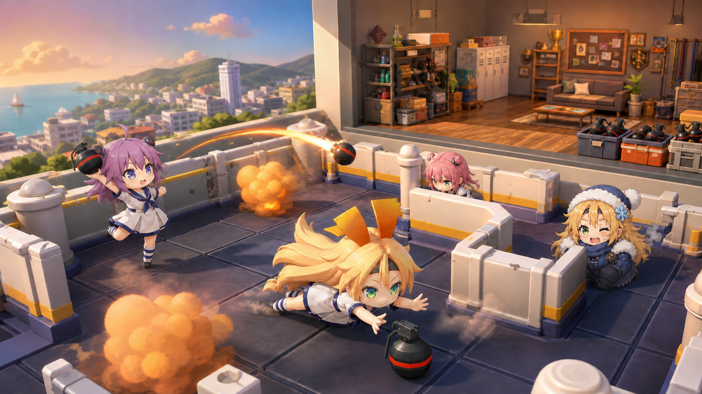
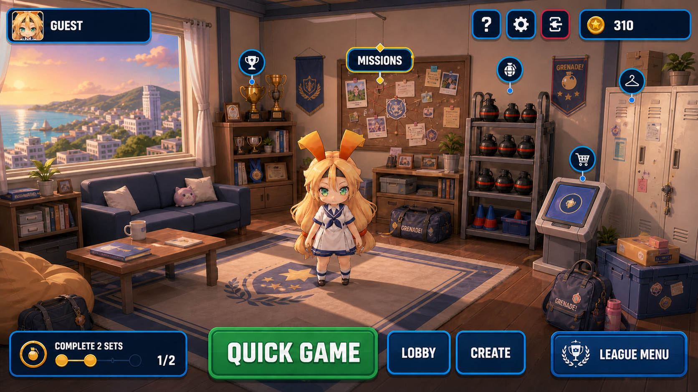
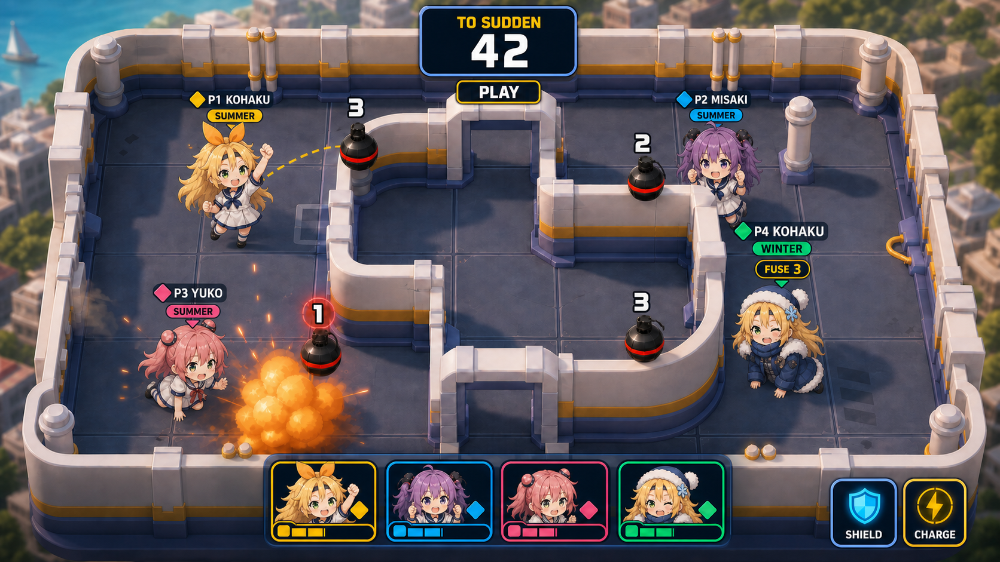
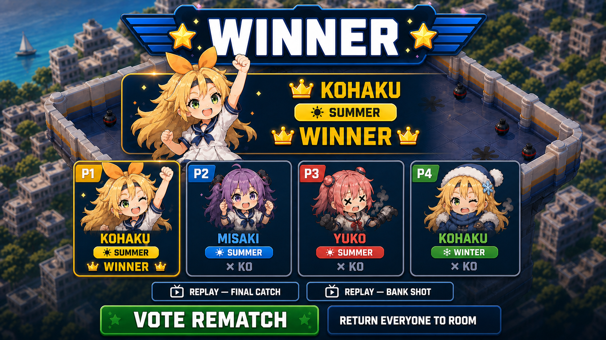

# Game-UI-Reference-Cli


[English](README.md) · [中文](README.zh.md) · [한국어](README.ko.md) · **日本語**

## GRENADE! — 実プロジェクトのショーケース

以下のコンセプトセットは、開発中の Unity ゲーム **GRENADE!** の UX/UI 仕様を制作する際に、`ui-ref` の正本契約パイプラインとコンパニオンワークフローを用いて確定した最終版です。同じ工程で、主要 10 画面、再利用コンポーネント 8 個、ユーザーフロー 24 本を構造化・検証し、決定的なワイヤーフレーム、クリック可能な状態プロトタイプ、Unity uGUI 引き渡しデータを生成しました。

| アートディレクション・キーフレーム | クラブルーム・ハブ |
| :---: | :---: |
| [](docs/showcase/grenade/01-art-direction-keyframe.png) | [](docs/showcase/grenade/02-club-room-hub.png) |
| **4 人対戦 HUD** | **リザルト／再戦画面** |
| [](docs/showcase/grenade/03-match-hud.png) | [](docs/showcase/grenade/04-result-rewards.png) |

> これらの画像は、アート方向、情報階層、構図を伝えるためのものです。画像内の文言、数値、通貨値は例示であり、実装の正本はレビュー済みの `ui_design` 契約です。

根拠に基づくゲーム UX/UI リサーチ兼仕様コンパイラです。`ui-ref` はリファレンス根拠を収集・索引化し、レビュー済みの判断をバージョン管理可能な画面／コンポーネント契約に変換し、そのトレーサビリティとライフサイクルを検証します。同じ原本から、決定的なワイヤーフレーム、読みやすい仕様、クリック可能なプロトタイプ、エンジン引き渡し用スキャフォールドを生成します。

中核ワークフローに外部依存はありません。JavaScript レンダリングのリファレンスサイトでは Playwright を任意で使い、動画からフレームを抽出するときだけ FFmpeg が必要です。

> このツールは AI の推測を承認済みデザインには変えません。リバースエンジニアリング結果は必ず `draft` として取り込まれ、最終承認には名前を記録した人間のレビュアーによる明示的な確認が必要です。

## v0.4.0 の概要

- **リファレンス根拠:** ローカルのスクリーンショットを索引化するか、明示的に列挙した公開ページだけを節度を守って収集します。各項目は出典パス／URL とハッシュ可能な来歴を保持します。
- **正本契約:** プロジェクト、トークン、フロー、リファレンス、判断、承認、画面、再利用コンポーネントをバージョン付き JSON で管理します。
- **品質ゲート:** ID、参照、バインディング、インタラクション、状態、アクセシビリティ、入力同等性、受け入れ基準、フロー、承認の鮮度を検証します。
- **AI 向けワイヤーフレーム:** 小さな `.uiwire` DSL を記述し、グラフィックス依存なしで決定的な注釈付き SVG をレンダリングします。
- **単一原本ビルド:** 契約をエンジン中立 Design IR、Markdown、HTML、レンダリング済みワイヤーフレームへコンパイルします。
- **クリックレビュー:** 画面遷移、シナリオ、キーボードフォーカス、ゲームパッドのポーリングを備えた静的プロトタイプを生成します。
- **エンジン引き渡し:** Unity UI Toolkit、Unity uGUI、Godot、Cocos 向けの明示的なスキャフォールドと機能／ハッシュ manifest を出力します。
- **根拠限定リバースエンジニアリング:** 任意のマルチモーダルモデルに渡せるスクリーンショット／動画パケットを作り、その主張を検証してドラフトとしてのみ取り込みます。

## 5 分ワークフロー

ゲームプロジェクトのルートで次を実行します。`--project-root` や `--design-root` などのグローバルオプションはコマンドより前に置きます。

```bash
# 1. 軽量なリサーチワークスペースを作る。
ui-ref init --project-name "My Game"

# 2. references/ui/<collection>/<category>/ に画像を置き、索引化する。
ui-ref scan-local

# 3. ui_design/ を作る。現在のローカル manifest は自動で取り込まれる。
ui-ref spec init --project-name "My Game" --platform pc --locale ja

# 4. 画面ドラフトとスターターワイヤーフレームを作る。
ui-ref spec add-screen "Main Menu" --id main-menu --wireframe

# ui_design/screens/main-menu.json と ui_design/wireframes/main-menu.uiwire を編集する。
ui-ref spec validate --strict

# 5. IR + Markdown/HTML + SVG ワイヤーフレームをコンパイルする。
ui-ref spec build

# 6. クリック可能な静的プロトタイプを作る。
ui-ref prototype build

# 7. エンジン引き渡し用スキャフォールドを生成する。
ui-ref export unity-uitoolkit
```

ブラウザーで `ui_design/build/design-spec.html` と `ui_design/build/prototype/index.html` を開きます。生成コマンドは、空でないカスタム出力ディレクトリを `--force` なしでは置き換えません。意図して更新するときだけ `--force` を使ってください。

後でリファレンスが変わった場合は次を実行します。

```bash
ui-ref scan-local
ui-ref spec import-references
ui-ref spec check
```

既存のリファレンス ID と人間が書いたメモは保持され、消えたソースファイルは黙って削除されず、欠落として記録されます。

## 正本ソースと生成物

`ui_design/` をデザインのソースコードとして扱ってください。

| パス | 役割 | コミット？ |
| --- | --- | --- |
| `ui_design/project.json` | プロジェクトメタデータ、パス、品質ゲート | はい |
| `ui_design/tokens.json`, `flows.json` | 共有デザイントークンとナビゲーションフロー | はい |
| `ui_design/references.json` | 根拠カタログと出典の権利／メモ | はい |
| `ui_design/decisions.json`, `approvals.json` | 判断とハッシュに結び付いたレビュー台帳 | はい |
| `ui_design/screens/*.json` | 正本画面契約 | はい |
| `ui_design/components/*.json` | 正本の再利用コンポーネント契約 | はい |
| `ui_design/wireframes/*.uiwire` | 正本テキストワイヤーフレーム | はい |
| `ui_design/schemas/` | ワークスペースの契約スキーマ | はい |
| `ui_design/build/` | 生成 IR、レポート、文書、SVG、プロトタイプ、export | いいえ。再ビルドする |
| `ui_design/analysis/` | 一時フレーム、パケット、プロンプト、contact sheet | いいえ。レビュー済み結果だけを正本契約へ取り込む |

リポジトリの `.gitignore` は `ui_design/build/` と `ui_design/analysis/` だけを無視します。正本デザインファイルは**無視しません**。

`ui-ref spec check` は契約検証、承認チェック、ワイヤーフレーム lint、生成物のドリフト検出をまとめて行います。生成された HTML、SVG、エンジンファイル、Design IR ではなく、正本 JSON／`.uiwire` を編集してください。

## ライフサイクルと承認の安全性

画面とコンポーネントには明示的なライフサイクルがあります。

```text
draft → reviewed → approved → deprecated
  ↑        │          │          │
  └────────┴──────────┴──────────┘  （改訂が必要なら draft に戻す）
```

昇格は単なる文字列変更ではなく、品質ゲートを通過する必要があります。

```bash
ui-ref spec promote screen main-menu \
  --to reviewed --by "UX reviewer" --note "状態、入力、受け入れ基準を確認"

ui-ref spec promote screen main-menu \
  --to approved --by "Design lead" --note "実装向けに承認" \
  --human-confirmed
```

- `reviewed` と `approved` はレビュー品質の完全性チェックを通過しなければなりません。
- 最終 `approved` には `--human-confirmed` が必要です。AI や import が最終承認を与えることはできません。
- 承認台帳には成果物と依存関係の両方のハッシュが保存されます。トークン、フロー、リファレンス、コンポーネントを変更すると承認が古くなり、再レビューまで検証は失敗します。
- 検証時にはローカル根拠の存在と SHA-256、コンポーネント参照、`project.json` で有効な全品質ゲートを再確認します。作成/import の `--force` が置換できるのは未レビューのドラフトだけです。
- `ui-ref spec trace screen main-menu` は根拠、バインディング、インタラクション、承認、依存関係のトレーサビリティを表示します。
- `ui-ref prototype build --release` と `ui-ref export <engine> --release` は未承認または無効なリリース入力を拒否します。

承認フラグはレビューの代わりではありません。名前を記録する担当者がその正確なリビジョンを確認してから `--human-confirmed` を使ってください。

## スクリーンショットと動画のリバースエンジニアリング

分析ワークフローはプロバイダー非依存であり、それ自体でメディアをアップロードしたりモデルを呼び出したりは**しません**。

```bash
# スクリーンショット、ディレクトリ、または混在入力
ui-ref analyze media ./captures/menu.png ./captures/hud/

# 動画フレーム抽出には PATH 上の ffmpeg が必要
ui-ref analyze media ./captures/gameplay.mp4 --interval 2 --frame-limit 120
```

`ui_design/analysis/<timestamp>/` の実行ディレクトリには次が生成されます。

- `analysis-packet.json` — 根拠 ID、パス、SHA-256 ハッシュ、寸法、タイムスタンプ
- `analysis-prompt.md` — 根拠ルールと必須の結果形式
- `analysis-result.schema.json` — 結果契約
- `contact-sheet.html` — ローカルレビューシート
- 動画を入力した場合は抽出フレーム

完全に同じファイル／フレームは SHA-256 で除去します。選んだマルチモーダルプロバイダーへパケット、プロンプト、引用画像を渡し、JSON 応答を保存してから取り込みます。

```bash
ui-ref analyze import result.json \
  --packet ui_design/analysis/<timestamp>/analysis-packet.json
```

import は根拠 ID、`observed` / `inferred` / `unknown` 分類、信頼度を検証します。プロバイダー／モデル／プロンプトの来歴を記録し、**ドラフト専用**の画面契約を作成または更新します。正確なパケットと根拠ハッシュは衝突耐性のあるリファレンス ID に結び付けられ、リファレンス・契約・ワイヤーフレームはすべて一括で反映されるか、まったく反映されません。`--force` を付けても、レビュー済み・承認済み・非推奨、またはレビュー履歴のあるドラフトは保持されます。ポーズ規則、初期フォーカス、正式なイベント、失敗処理のような見えない実行時挙動は、別の根拠で確立されない限り `unknown` のままにします。

## ワイヤーフレームとビルド出力

行指向の `.uiwire` 原本を作成、検査、レンダリングします。

```bash
ui-ref wireframe new main-menu
ui-ref wireframe lint ui_design/wireframes/main-menu.uiwire
ui-ref wireframe render ui_design/wireframes/main-menu.uiwire
```

原本はバージョンと canvas で始まり、安定した要素 ID と key/value の幾何情報が続きます。ラベルと callout は SVG 出力前にエスケープされます。

```text
uiwire 1
canvas 1920 1080
button A1 x=720 y=420 w=480 h=96 label="Start"
callout A1 side=right text="Primary action"
```

`ui-ref spec compile` はエンジン中立の `design.ir.json` だけを書き出します。`ui-ref spec build` はさらに `design-spec.md`、読みやすい `design-spec.html`、注釈付き SVG ワイヤーフレーム、ソース／出力ハッシュ入り `build-manifest.json` を生成します。

## プロトタイプとエンジン引き渡し

```bash
ui-ref prototype build
ui-ref export unity-uitoolkit
ui-ref export unity-ugui
ui-ref export godot
ui-ref export cocos
```

`--screen <id>` で 1 画面だけを出力し、`--release` で最新の人間承認を必須にできます。記述済みの `flows.json` はプロトタイプの開始画面と遷移を駆動し、同じアクションに競合する遷移先があると検証に失敗します。各エンジンディレクトリには `engine-ir.json`、`capability-report.json`、`export-manifest.json` が入り、毎回生成セット全体を原子的に置換するため削除済み画面は残りません。

これらは**実装引き渡し用スキャフォールドであり、本番投入可能なエンジンプロジェクトではありません**。

| 対象 | 生成内容 | 手動／プロジェクト固有の作業 |
| --- | --- | --- |
| Unity UI Toolkit | 画面別 UXML、`tokens.uss`、バインディング／イベント JSON | 実行時バインディング、プロジェクト資産、レスポンシブ調整、音声／ハプティクス |
| Unity uGUI | RectTransform／コンポーネント引き渡し JSON | Unity 側 importer と実際の prefab シリアライズ |
| Godot | 画面別 `Control` `.tscn`、バインディング／イベント JSON | Theme リソース、資産、signal、GDScript |
| Cocos | ノード／コンポーネント／UITransform 引き渡し JSON | バージョン固有 prefab シリアライズとエディター adapter |

必ず `capability-report.json` を読んでください。契約データが保持される範囲と、手動／損失を伴う作業との境界を明示します。

## インストールとテスト

```bash
git clone https://github.com/SillyToolValley/Game-UI-Reference-Cli
cd Game-UI-Reference-Cli
python -m pip install -e .
ui-ref --version
```

中核コマンドは Python 3.10+ の標準ライブラリだけを使います。JavaScript レンダリングのリファレンスサイトを使う場合:

```bash
python -m pip install -e ".[browser]"
playwright install chromium
```

動画分析には FFmpeg を別途インストールし、`ffmpeg` が `PATH` 上にあることを確認してください。スクリーンショット分析には不要です。

標準ライブラリで回帰テストを実行します。

```bash
python -m unittest discover -s tests -v
```

## リファレンス収集（従来ワークフロー、引き続き対応）

従来の `init`、`scan-local`、`collect` ワークフローはそのまま互換です。収集は意図的に保守的です。

- まずローカルリファレンスを索引化します。
- 利用者が**明示的に列挙した**外部 URL だけを取得し、クロールしません。
- 要求しない限り資産をダウンロードしません。
- リクエスト間隔、実行ごとのページ上限、`robots.txt` チェック、公開ネットワーク URL チェック、応答サイズ制限を内蔵します。

ログインが必要なギャラリーは対象外です。これは個人リサーチ補助であり、汎用スクレイパーでも他者の資産を再配布する手段でもありません。各サイトの規約、著作権、`robots.txt` を守ってください。

### ローカルリファレンスの索引化

ファイルを `references/ui/<collection>/<category>/` に置き、実行します。

```bash
ui-ref scan-local
```

PNG/GIF/JPEG/WebP のバイト列から画像寸法を読み、フォルダーパスから大まかなタグを推定して、次を書き出します。

```text
ui_research/manifests/local_ui_refs_manifest.json
ui_research/manifests/local_ui_refs_manifest.md
```

### 明示的に列挙したページの収集

`ui_research/urls.txt` に 1 行 1 URL を置くか、`--url` を繰り返します。

```bash
# JS レンダリングサイトでは任意のブラウザーパスを使う。
ui-ref collect --browser

# 少数の画像をダウンロードし、遅延読込コンテンツのためにスクロールする。
ui-ref collect --browser --scroll 6 \
  --download-gallery-assets --download-asset-limit 2

# 未知のサイトでは抽出方法を強制する。
ui-ref collect --browser --mode images
ui-ref collect --browser --gallery-class "thumb-card"
```

各実行は `ui_research/manifests/` に `collected_pages_<run_id>.json` と、ブラウザーで見られる `contact_sheet_<run_id>.html` を書きます。主なオプションは `--site`、`--mode`、`--gallery-class`、`--scroll`、`--max-pages`、`--delay`、`--timeout`、`--keep-*`、`--download-full-images`、`--no-headless` です。

### 対応サイトとモード

- `gallery`: 構造化された gallery anchor とメタデータを読みます。
- `images`: 明らかなページ装飾を除外しながら、レンダリング済み ``／`srcset` 候補を収集します。

| サイトキー | ドメイン | モード | 備考 |
| --- | --- | --- | --- |
| `gameuidatabase` | gameuidatabase.com | gallery | 構造化 Game UI Database ギャラリー。`--browser` を使用。 |
| `interfaceingame` | interfaceingame.com | images | ゲーム UI スクリーンショット。 |
| `screenlane` | screenlane.com | images | モバイル UI/UX フロー。 |
| `collectui` | collectui.com | images | 日々の UI インスピレーション。 |
| `landbook` | land-book.com | images | ランディングページギャラリー。 |
| `lapaninja` | lapa.ninja | images | ランディングページ例。 |
| `refero` | refero.design | images | Web/iOS UI の参考。 |
| `dribbble` | dribbble.com | images | 公開デザインショット。 |
| `behance` | behance.net | images | 公開クリエイティブショーケース。 |

未知の公開サイトは既定で `images` を使います。サイトを追加するには、`ui_ref_cli.py` の `SITE_PRESETS` に `match`、`mode`、任意の `gallery_class`、`notes` を追加します。構造化メタデータの属性が異なる場合だけ `LinkExtractor` を拡張してください。

### 設定探索とエチケット

`--config` がなければ次の順で探索します。

```text
ui_ref_config.json
ui_research/ui_ref_config.json
docs/ui_research/ui_ref_config.json
```

グローバル `--project-root` で別プロジェクトを指定し、`--design-root` で `ui_design` を上書きできます。収集は小さく、ゆっくり行ってください。既定値はリクエスト間 8 秒、1 実行 20 ページです。収集物は引用付きのリサーチ文脈として扱い、資産パックや学習コーパスとして扱わないでください。

## DOCX/PDF と詳細デザイン文書のための同梱スキル

v0.4.0 の中核ビルドは、意図的に JSON Design IR、Markdown、HTML、SVG、静的プロトタイプファイルを生成します。DOCX や PDF は直接生成**しません**。

リポジトリの checkout に含まれる [`game-ux-ui-design` コンパニオンスキル](.claude/skills/game-ux-ui-design/) は、GDD バインディング、画面別の根拠説明、密度の高い凡例／状態表、デザイントークン、判断追跡、アートコンセプト brief、文書レンダリングを含む長文デザイン文書ワークフローを追加します。テンプレートには [`build_docx.py`](.claude/skills/game-ux-ui-design/templates/build_docx.py) と [`build_pdf.py`](.claude/skills/game-ux-ui-design/templates/build_pdf.py) があります。関係者向け DOCX/PDF が必要な場合はこのコンパニオンを使い、機械可読な原本は正本 `ui_design` 契約として維持してください。

Python wheel がインストールするのは `ui-ref` CLI のみで、このコンパニオンスキルのインストールや登録は行いません。コンパニオンワークフローが必要な場合は、リポジトリを clone/download するか、`.claude/skills/game-ux-ui-design/` を使用中のアシスタントが対応するスキル配置先へコピーしてください。

## リポジトリ内の再現可能な完全版サンプル

公開済みの完全なコンパニオンスキル例は [`examples/lucid-dawn/`](examples/lucid-dawn/) にあります。文書化された 12 画面、13 個の注釈付きワイヤーフレーム、トークン、判断、引用、英語／中国語／韓国語／日本語のデザイン文書を含みます。

完全な例: [英語](examples/lucid-dawn/lucid_dawn_ui_ux_design.en.md) · [中国語](examples/lucid-dawn/lucid_dawn_ui_ux_design.zh.md) · [韓国語](examples/lucid-dawn/lucid_dawn_ui_ux_design.ko.md) · [日本語](examples/lucid-dawn/lucid_dawn_ui_ux_design.ja.md) · [PDF](examples/lucid-dawn/lucid_dawn_ui_ux_design.en.pdf)。

## コマンドリファレンス

| コマンド | 用途 |
| --- | --- |
| `ui-ref init` | リファレンスリサーチと設定を初期化 |
| `ui-ref scan-local` | ローカルリファレンスメディアを索引化 |
| `ui-ref collect` | 明示的に列挙した公開リファレンスページを収集 |
| `ui-ref spec init` | 正本契約ワークスペースを初期化。`design` は `spec` の別名 |
| `ui-ref spec add-screen` / `add-component` | 契約ドラフトを作成 |
| `ui-ref spec import-references` | 最新ローカル manifest を根拠カタログへ同期 |
| `ui-ref spec validate [--strict]` | 構造、意味、ライフサイクルゲート、承認を検証 |
| `ui-ref spec check [--strict]` | 検証 + ワイヤーフレーム lint + 生成物ドリフト検出 |
| `ui-ref spec compile` | エンジン中立 Design IR をビルド |
| `ui-ref spec build` | IR、Markdown、HTML、注釈 SVG、ハッシュ manifest をビルド |
| `ui-ref spec promote` | ゲート付きライフサイクル遷移と台帳記録 |
| `ui-ref spec trace` | 根拠と依存関係のトレーサビリティを報告 |
| `ui-ref wireframe new/lint/render` | `.uiwire` を作成、検証、レンダリング |
| `ui-ref prototype build [--release]` | クリック可能な静的プロトタイプをビルド |
| `ui-ref analyze media/import` | 根拠パケットを準備し、検証済み AI 結果をドラフトとして import |
| `ui-ref export <engine> [--screen ID] [--release]` | エンジン引き渡し用スキャフォールドを生成 |

すべてのオプションは `ui-ref <command> --help` で確認できます。

## ライセンス

MIT — [LICENSE](LICENSE) を参照してください。

プロジェクト文書: [変更履歴](CHANGELOG.md) · [コントリビューション](CONTRIBUTING.md) · [セキュリティポリシー](SECURITY.md)
