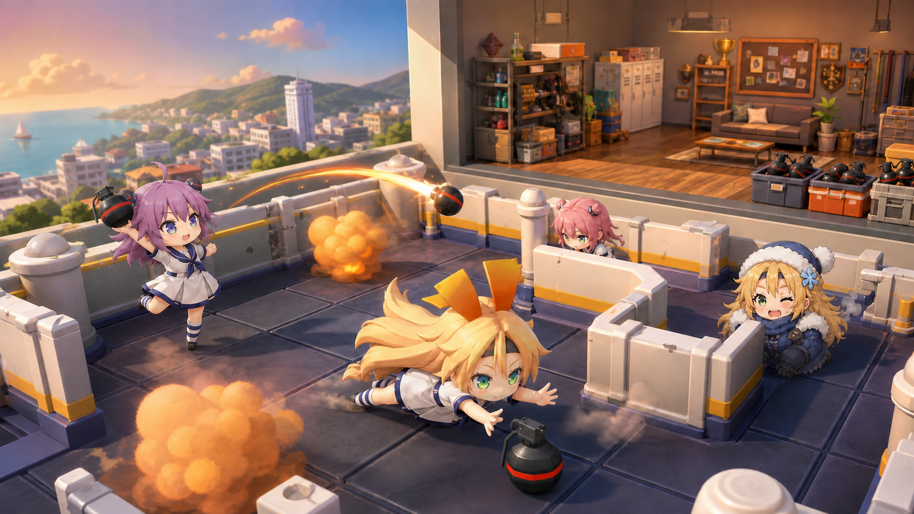
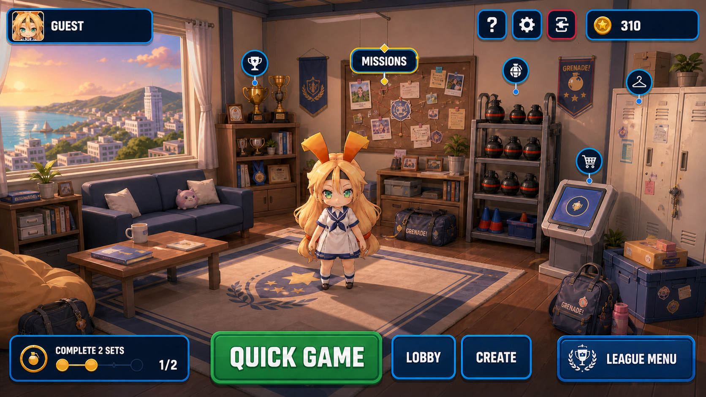
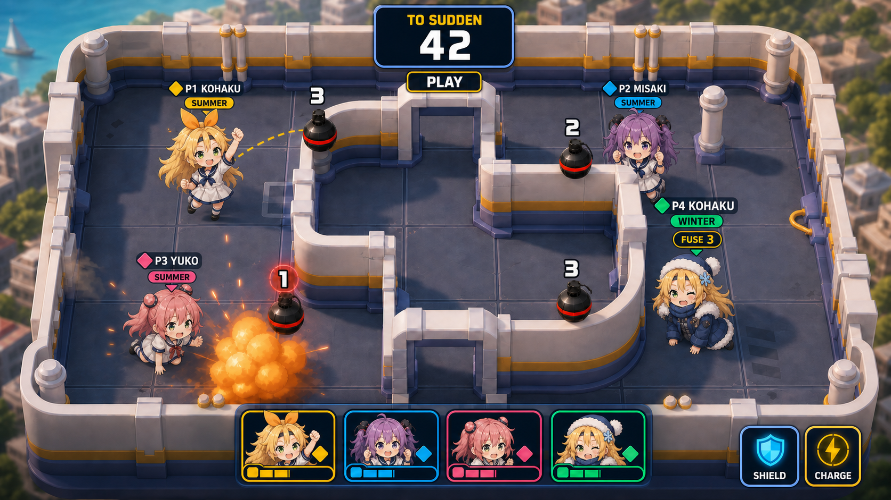
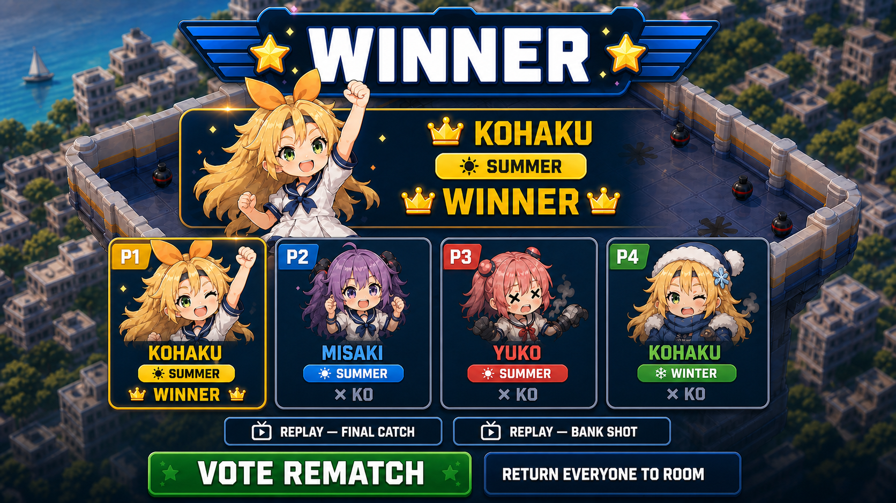

# game-ux-ui-skill


**English** · [中文](README.zh.md) · [한국어](README.ko.md) · [日本語](README.ja.md)

A game UX/UI design skill for AI coding agents (Claude Code and other SKILL.md-compatible agents), with a small CLI that keeps the loop honest. Formerly *Game-UI-Reference-Cli*.

Pick **one** shipped game's screen as the anchor, read it closely, build your screen at full fidelity, then put a screenshot of your build next to the anchor and close the gap. Repeat up to three times.

## Why anchor-first

Earlier versions of this project collected many references, compiled them into JSON screen contracts with approval gates, and rendered grey wireframes. The output looked thorough. In practice, handing a frontier model one screenshot of a strong shipped game produced better screens.

The reasons are structural:

- A shipped screen is hundreds of decisions tuned against each other. Blending several references, or abstracting them into contracts before anything is drawn, discards that tuning and regresses to the genre average.
- A model matches what it can see. One concrete image sets a quality bar; a description of twelve images does not.
- Specification before the first render spends effort where it pays least. The general-purpose UI skills that work well put their weight after the first render: look at the result, compare, fix.

So v0.5 makes the single anchor the default path and turns the contract pipeline into an optional handoff stage.

## The anchor loop

```bash
# 1. Register the one shipped screen this screen is anchored on.
ui-ref anchor add captures/reward-screen.png --screen level-up \
  --game "<game title>" --source-url "<where it came from>"

# 2. Fill in ui_anchor/level-up/ANATOMY.md from the image:
#    measured proportions, type sizes, colour roles, why it works, keep / change / drop.

# 3. Build the real screen (HTML or in your engine), then screenshot it into a round.
ui-ref shot build/level-up.html --screen level-up
#    Engine build? Bring your own capture instead:
ui-ref compare captures/unity-level-up.png --screen level-up

# 4. Open ui_anchor/level-up/rounds/01/compare.html, fill in critique.md, fix the top three gaps.

# 5. Hold the floor: text size, contrast, safe area, clipping, initial focus.
ui-ref audit build/level-up.html --platform tv
```

| Command | What it does | Needs |
| --- | --- | --- |
| `ui-ref anchor add` | Stores one hero anchor per screen with source, hash, size, and extracted palette; writes the `ANATOMY.md` template. Refuses a second hero. Allows at most two supports, each with a named `--borrow`. | Standard library (palette needs the browser extra) |
| `ui-ref anchor show` | Lists anchors, how much of each anatomy is filled in, and rounds run. | Standard library |
| `ui-ref shot` | Screenshots an HTML file or URL at the anchor's size and starts a comparison round. | Browser extra |
| `ui-ref compare` | Writes a side-by-side sheet with squint (blur), values (greyscale), safe-area and thirds guides, overlay, and flicker, plus a nine-lens critique template. Works with any screenshot, including engine captures. | Standard library |
| `ui-ref audit` | Deterministic floor checks on an HTML build per platform preset (`tv`, `desktop`, `handheld`, `mobile`). Reports what it could not assess. Exits non-zero on failures. | Browser extra |

`audit` holds the floor. It cannot tell you a screen is good; `compare` and your eyes do that.

## The skill

[`.claude/skills/game-ux-ui-design/`](.claude/skills/game-ux-ui-design/) is the agent-facing half. Copy it into your project's skill directory. Its `SKILL.md` is a short router; the detail loads on demand:

| File | Contents |
| --- | --- |
| `references/anchor-workflow.md` | Choosing a hero, reading it, translating it (keep structure, change identity), a worked example. |
| `references/finding-anchors.md` | Where anchors come from, how to capture them, and what gallery sites allow. |
| `references/game-ui-tells.md` | What model-made game UI converges on, and what shipped games do instead. |
| `references/platform-numbers.md` | Text size, contrast, safe area, touch, and localisation floors, each with its source and verification status. |
| `references/feel-and-states.md` | Timing starting values, focus and navigation rules, the states that break layouts. |
| `references/spec-pipeline.md` | The optional contract, wireframe, prototype, and engine-handoff workflow. |

### A note on reference sites

Use gallery sites to discover which game does a screen best, then capture that screen yourself. Game UI Database's robots.txt (checked November 2026) disallows AI agents and AI training crawlers and marks its content `ai-train=no, use=reference`. `ui-ref collect` therefore refuses its URLs and the old site preset is gone. Check any site's current terms and robots rules before collecting from it.

## What this borrows from other skills

The redesign followed a review of widely used general-purpose UI skills and game-specific ones. The ideas taken, and where they came from:

- **One concrete reference as the source of truth** — the DESIGN.md convention (Google's `design.md`, `VoltAgent/awesome-design-md`).
- **Named convergence defaults, a short plan before building, boldness spent in one place, and looking at the render** — Anthropic's `frontend-design` skill.
- **Narrow verbs, deterministic checks kept separate from design judgement, a capped number of rounds, critique by a reviewer who did not write the work** — `pbakaus/impeccable` and `Leonxlnx/taste-skill`.
- **A thin router with on-demand references and honest "not assessed" verdicts** — `Donchitos/Claude-Code-Game-Studios`, `gamedev-skills/awesome-gamedev-agent-skills`.
- **Cited numbers with a verification status per row** — `fcsouza/agent-skills`.

None of the skills reviewed puts a contract-and-wireframe compile stage before the first render.

## Optional: the spec and handoff pipeline

When a team needs a written specification, an approval trail, a clickable flow prototype, or engine scaffolds, the v0.4 pipeline is still here and unchanged. Run it after the screen exists.

### GRENADE! — real-project showcase

The concept set below was finalized while using the contract pipeline and companion workflow to produce the UX/UI specification for **GRENADE!**, an in-development Unity game. That pass structured and validated 10 core screens, 8 reusable components, and 24 user flows, then generated deterministic wireframes, a clickable state prototype, and Unity uGUI handoff data.

| Art-direction keyframe | Club Room Hub |
| :---: | :---: |
| [](docs/showcase/grenade/01-art-direction-keyframe.png) | [](docs/showcase/grenade/02-club-room-hub.png) |
| **Match HUD** | **Result and rematch** |
| [](docs/showcase/grenade/03-match-hud.png) | [](docs/showcase/grenade/04-result-rewards.png) |

> These images communicate art direction, information hierarchy, and composition. Their labels, values, and economy numbers are illustrative; reviewed `ui_design` contracts remain the implementation source of truth.

The pipeline collects and indexes reference evidence, turns reviewed decisions into versioned screen/component contracts, validates their traceability and lifecycle, and generates deterministic wireframes, readable specs, clickable prototypes, and engine handoff scaffolds.

It stays dependency-free for its core workflow. Playwright is optional for JavaScript-rendered reference sites, and FFmpeg is only needed when extracting frames from video.

> The tool does not turn an AI guess into an approved design. Reverse-engineered results are imported as `draft`, and final approval always requires an explicitly named human reviewer.

### Pipeline at a glance

- **Reference evidence:** index local screenshots or politely collect explicitly listed public pages; every item keeps a source path/URL and hashable provenance.
- **Canonical contracts:** versioned JSON for projects, tokens, flows, references, decisions, approvals, screens, and reusable components.
- **Quality gates:** validate IDs, references, bindings, interactions, states, accessibility, input parity, acceptance criteria, flows, and approval freshness.
- **AI-friendly wireframes:** author a small `.uiwire` DSL and render deterministic, annotated SVG without a graphics dependency.
- **One-source build:** compile the contracts into engine-neutral Design IR, Markdown, HTML, and rendered wireframes.
- **Clickable review:** generate a static prototype with screen navigation, conditional visibility, scenario-specific geometry, keyboard focus, and gamepad polling.
- **Engine handoff:** export explicit scaffolds for Unity UI Toolkit, Unity uGUI, Godot, and Cocos, with capability and hash manifests.
- **Evidence-bounded reverse engineering:** prepare screenshot/video packets for any multimodal model, then validate and import its claims as drafts only.

### Pipeline workflow

Run these commands from your game project root. Global options such as `--project-root` and `--design-root` go before the command.

```bash
# 1. Create the lightweight research workspace.
ui-ref init --project-name "My Game"

# 2. Put screenshots under references/ui/<collection>/<category>/, then index them.
ui-ref scan-local

# 3. Create ui_design/. The current local manifest is imported automatically.
ui-ref spec init --project-name "My Game" --platform pc --locale en

# 4. Add a draft screen and starter wireframe.
ui-ref spec add-screen "Main Menu" --id main-menu --wireframe

# Edit ui_design/screens/main-menu.json and ui_design/wireframes/main-menu.uiwire.
ui-ref spec validate --strict

# 5. Compile IR + Markdown/HTML + SVG wireframes.
ui-ref spec build

# 6. Build a clickable static prototype.
ui-ref prototype build

# 7. Generate an engine handoff scaffold.
ui-ref export unity-uitoolkit
```

Open `ui_design/build/design-spec.html` and `ui_design/build/prototype/index.html` in a browser. Generated commands refuse to replace a non-empty custom output directory unless `--force` is supplied; use `--force` when intentionally refreshing it.

When references change later, run:

```bash
ui-ref scan-local
ui-ref spec import-references
ui-ref spec check
```

Existing reference IDs and human notes are preserved; missing source files are marked rather than silently deleted.

## Canonical source vs generated output

Treat `ui_design/` as source code for the design.

| Path | Role | Commit it? |
| --- | --- | --- |
| `ui_design/project.json` | Project metadata, paths, and quality gates | Yes |
| `ui_design/tokens.json`, `flows.json` | Shared design tokens and navigation flows | Yes |
| `ui_design/references.json` | Evidence catalog and source rights/notes | Yes |
| `ui_design/decisions.json`, `approvals.json` | Decision and hash-bound review ledgers | Yes |
| `ui_design/screens/*.json` | Canonical screen contracts | Yes |
| `ui_design/components/*.json` | Canonical reusable component contracts | Yes |
| `ui_design/wireframes/*.uiwire` | Canonical text wireframes | Yes |
| `ui_design/schemas/` | The workspace's contract schema | Yes |
| `ui_design/build/` | Generated IR, reports, docs, SVG, prototype, and exports | No; rebuild it |
| `ui_design/analysis/` | Temporary frames, packets, prompts, and contact sheets | No; import reviewed results into canonical contracts |

The repository `.gitignore` ignores only `ui_design/build/` and `ui_design/analysis/`; it does **not** ignore the canonical design files.

`ui-ref spec check` combines contract validation, approval checks, wireframe linting, and generated-output drift detection. Edit canonical JSON/`.uiwire`, not generated HTML, SVG, engine files, or Design IR.

## Lifecycle and approval safety

Screens and components use an explicit lifecycle:

```text
draft → reviewed → approved → deprecated
  ↑        │          │          │
  └────────┴──────────┴──────────┘  (return to draft when revision is needed)
```

Promotions are gated rather than simple string edits:

```bash
ui-ref spec promote screen main-menu \
  --to reviewed --by "UX reviewer" --note "States, inputs, and acceptance checked"

ui-ref spec promote screen main-menu \
  --to approved --by "Design lead" --note "Approved for implementation" \
  --human-confirmed
```

- `reviewed` and `approved` must pass review-grade completeness checks.
- Final `approved` requires `--human-confirmed`; an AI/import cannot supply final approval.
- The approval ledger stores hashes for both the artifact and its dependencies. Changing tokens, flows, references, or components makes the approval stale and validation fails until it is reviewed again.
- Validation rechecks local evidence existence and SHA-256, component references, and every enabled `project.json` quality gate. `--force` creation/import can replace only a never-reviewed draft.
- `ui-ref spec trace screen main-menu` shows evidence, bindings, interactions, approval, and dependency traceability.
- `ui-ref prototype build --release` and `ui-ref export <engine> --release` reject unapproved or invalid release inputs.

An approval flag is not a substitute for review: use `--human-confirmed` only after the named person has inspected that exact revision.

## Reverse-engineering screenshots and video

The analysis workflow is provider-neutral and does **not** upload media or call a model on its own.

```bash
# Screenshots, directories, or a mixture of inputs
ui-ref analyze media ./captures/menu.png ./captures/hud/

# Video frame extraction requires ffmpeg on PATH
ui-ref analyze media ./captures/gameplay.mp4 --interval 2 --frame-limit 120
```

The run under `ui_design/analysis/<timestamp>/` contains:

- `analysis-packet.json` — evidence IDs, paths, SHA-256 hashes, dimensions, and timestamps;
- `analysis-prompt.md` — the evidence rules and required result shape;
- `analysis-result.schema.json` — the result contract;
- `contact-sheet.html` — a local review sheet;
- extracted frames when video was supplied.

Exact duplicate files/frames are removed by SHA-256. Give the packet, prompt, and cited images to the multimodal provider you choose, save its JSON response, then import it:

```bash
ui-ref analyze import result.json \
  --packet ui_design/analysis/<timestamp>/analysis-packet.json
```

Import validates evidence IDs, `observed` / `inferred` / `unknown` classifications, and confidence values. It records provider/model/prompt provenance and creates or updates **draft-only** screen contracts. The exact packet and evidence hashes are bound to collision-resistant reference IDs, and references, contracts, and wireframes commit together or not at all. Even with `--force`, reviewed, approved, deprecated, or previously reviewed drafts are preserved. Hidden runtime behavior—pause rules, initial focus, canonical events, failure handling—must remain `unknown` unless other evidence establishes it.

## Wireframes and build outputs

Create, lint, and render the line-oriented `.uiwire` source:

```bash
ui-ref wireframe new main-menu
ui-ref wireframe lint ui_design/wireframes/main-menu.uiwire
ui-ref wireframe render ui_design/wireframes/main-menu.uiwire
```

A source starts with a version and canvas, followed by stable element IDs and key/value geometry. Labels and callouts are escaped before SVG output.

```text
uiwire 1
canvas 1920 1080
button A1 x=720 y=420 w=480 h=96 label="Start"
callout A1 side=right text="Primary action"
```

`ui-ref spec compile` writes only the engine-neutral `design.ir.json`. `ui-ref spec build` additionally writes `design-spec.md`, readable `design-spec.html`, annotated SVG wireframes, and `build-manifest.json` with source/output hashes.

## Prototype and engine handoff

```bash
ui-ref prototype build
ui-ref export unity-uitoolkit
ui-ref export unity-ugui
ui-ref export godot
ui-ref export cocos
```

Use `--screen <id>` to export one screen and `--release` to require current human approvals. Authored `flows.json` steps drive prototype entry/navigation, and conflicting action targets fail validation. Every engine directory includes `engine-ir.json`, `capability-report.json`, and `export-manifest.json`; each export atomically replaces the prior generated set so removed screens cannot linger.

These are **implementation handoff scaffolds, not production-ready engine projects**:

| Target | Generated | Still manual/project-specific |
| --- | --- | --- |
| Unity UI Toolkit | Per-screen UXML, `tokens.uss`, binding/event JSON | Runtime bindings, project assets, responsive refinement, audio/haptics |
| Unity uGUI | RectTransform/component handoff JSON | Unity-side importer and actual prefab serialization |
| Godot | Per-screen `Control` `.tscn`, binding/event JSON | Theme resources, assets, signals, and GDScript |
| Cocos | Node/component/UITransform handoff JSON | Version-specific prefab serialization and editor adapter |

Always read `capability-report.json`; it is the explicit boundary between preserved contract data and manual/lossy work.

## Install and test

```bash
git clone https://github.com/SillyToolValley/game-ux-ui-skill
cd game-ux-ui-skill
python -m pip install -e .
ui-ref --version
```

The core commands use only Python 3.10+ standard-library modules. For `shot`, `audit`, palette extraction, and JavaScript-rendered reference pages:

```bash
python -m pip install -e ".[browser]"
playwright install chromium
```

For video analysis, install FFmpeg separately and make sure `ffmpeg` is on `PATH`. Screenshot analysis does not require it.

Run the regression suite with the standard library:

```bash
python -m unittest discover -s tests -v
```

## Reference collection (for sites that permit it)

The original `init`, `scan-local`, and `collect` workflow remains compatible. Collection is intentionally conservative:

- local references are indexed first;
- external URLs are fetched **only when you list them**—there is no crawler;
- assets are not downloaded unless requested;
- a politeness delay, per-run page cap, `robots.txt` check, public-network URL checks, and response-size limits are built in.

Login-walled galleries are out of scope. This is a personal research helper, not a general-purpose scraper or a way to redistribute other people's assets. Respect site terms, copyright, and `robots.txt`.

### Index local references

Place files under `references/ui/<collection>/<category>/`, then run:

```bash
ui-ref scan-local
```

It reads image dimensions from PNG/GIF/JPEG/WebP bytes, infers coarse folder-path tags, and writes:

```text
ui_research/manifests/local_ui_refs_manifest.json
ui_research/manifests/local_ui_refs_manifest.md
```

### Collect explicitly listed pages

Put one URL per line in `ui_research/urls.txt`, or repeat `--url`:

```bash
# JS-rendered sites: use the optional browser path.
ui-ref collect --browser

# Download a small number of images and scroll for lazy-loaded content.
ui-ref collect --browser --scroll 6 \
  --download-gallery-assets --download-asset-limit 2

# Force extraction behavior for an unknown site.
ui-ref collect --browser --mode images
ui-ref collect --browser --gallery-class "thumb-card"
```

Each run writes `collected_pages_<run_id>.json` and a browsable `contact_sheet_<run_id>.html` under `ui_research/manifests/`. Useful options include `--site`, `--mode`, `--gallery-class`, `--scroll`, `--max-pages`, `--delay`, `--timeout`, `--keep-*`, `--download-full-images`, and `--no-headless`.

### Supported sites and modes

- `gallery`: reads structured gallery anchors and metadata.
- `images`: harvests rendered ``/`srcset` candidates while filtering obvious page chrome.

| Site key | Domain | Mode | Notes |
| --- | --- | --- | --- |
| `interfaceingame` | interfaceingame.com | images | Game UI screenshots. |
| `screenlane` | screenlane.com | images | Mobile UI/UX flows. |
| `collectui` | collectui.com | images | Daily UI inspiration. |
| `landbook` | land-book.com | images | Landing-page gallery. |
| `lapaninja` | lapa.ninja | images | Landing-page examples. |
| `refero` | refero.design | images | Web/iOS UI inspiration. |
| `dribbble` | dribbble.com | images | Public design shots. |
| `behance` | behance.net | images | Public creative showcase. |

Unknown public sites default to `images`. Add a site by extending `SITE_PRESETS` in `ui_ref_cli.py` with `match`, `mode`, optional `gallery_class`, and `notes`; extend `LinkExtractor` only if its structured metadata uses different attributes.

### Config discovery and etiquette

Without `--config`, the CLI searches in this order:

```text
ui_ref_config.json
ui_research/ui_ref_config.json
docs/ui_research/ui_ref_config.json
```

Use global `--project-root` to work on another project and `--design-root` to override `ui_design`. Keep collection runs small and slow—the defaults are an 8-second delay and 20 pages per run. Treat collected material as cited research context, not an asset pack or training corpus.

## Companion skill for DOCX/PDF and deeper design documents

The core v0.4.0 build intentionally emits JSON Design IR, Markdown, HTML, SVG, and static prototype files. It does **not** directly generate DOCX or PDF.

The [`game-ux-ui-design` companion skill](.claude/skills/game-ux-ui-design/) included in a repository checkout adds the long-form design-document workflow: GDD binding, screen-by-screen rationale, dense legend/state tables, design tokens, decision tracking, art-concept briefs, and document rendering. Its templates include [`build_docx.py`](.claude/skills/game-ux-ui-design/templates/build_docx.py) and [`build_pdf.py`](.claude/skills/game-ux-ui-design/templates/build_pdf.py). Use that companion when a stakeholder-ready DOCX/PDF is required; keep the canonical `ui_design` contracts as the machine-readable source of truth.

The Python wheel installs the `ui-ref` CLI only; it does not install or register this companion skill. Clone/download the repository (or copy `.claude/skills/game-ux-ui-design/` into your assistant's supported skill location) when you need the companion workflow.

## Reproducible included example

A full public companion-skill example lives in [`examples/lucid-dawn/`](examples/lucid-dawn/): 12 documented screens, 13 annotated wireframes, tokens, decisions, citations, and English/Chinese/Korean/Japanese design documents.

Read the full example: [English](examples/lucid-dawn/lucid_dawn_ui_ux_design.en.md) · [Chinese](examples/lucid-dawn/lucid_dawn_ui_ux_design.zh.md) · [Korean](examples/lucid-dawn/lucid_dawn_ui_ux_design.ko.md) · [Japanese](examples/lucid-dawn/lucid_dawn_ui_ux_design.ja.md) · [PDF](examples/lucid-dawn/lucid_dawn_ui_ux_design.en.pdf).

## Command reference

| Command | Purpose |
| --- | --- |
| `ui-ref anchor add` / `show` | Register and inspect the hero anchor for each screen. |
| `ui-ref shot` | Screenshot an HTML build and start a comparison round. |
| `ui-ref compare` | Build the anchor-versus-candidate sheet and critique template. |
| `ui-ref audit` | Run platform floor checks on an HTML build. |
| `ui-ref init` | Initialize reference research and config. |
| `ui-ref scan-local` | Index local reference media. |
| `ui-ref collect` | Fetch explicitly listed public reference pages. |
| `ui-ref spec init` | Initialize the canonical contract workspace. `design` is an alias for `spec`. |
| `ui-ref spec add-screen` / `add-component` | Create draft contracts. |
| `ui-ref spec import-references` | Synchronize the latest local manifest into the evidence catalog. |
| `ui-ref spec validate [--strict]` | Validate structure, semantics, lifecycle gates, and approvals. |
| `ui-ref spec check [--strict]` | Validate plus lint wireframes and detect generated-output drift. |
| `ui-ref spec compile` | Build engine-neutral Design IR. |
| `ui-ref spec build` | Build IR, Markdown, HTML, annotated SVG, and hash manifest. |
| `ui-ref spec promote` | Perform a gated lifecycle transition and record its ledger entry. |
| `ui-ref spec trace` | Report evidence and dependency traceability. |
| `ui-ref wireframe new/lint/render` | Create, validate, and render `.uiwire`. |
| `ui-ref prototype build [--release]` | Build the static clickable prototype. |
| `ui-ref analyze media/import` | Prepare evidence packets and import validated AI results as drafts. |
| `ui-ref export <engine> [--screen ID] [--release]` | Generate an engine handoff scaffold. |

Use `ui-ref <command> --help` for every option.

## License

MIT — see [LICENSE](LICENSE).

Project docs: [Changelog](CHANGELOG.md) · [Contributing](CONTRIBUTING.md) · [Security policy](SECURITY.md)
